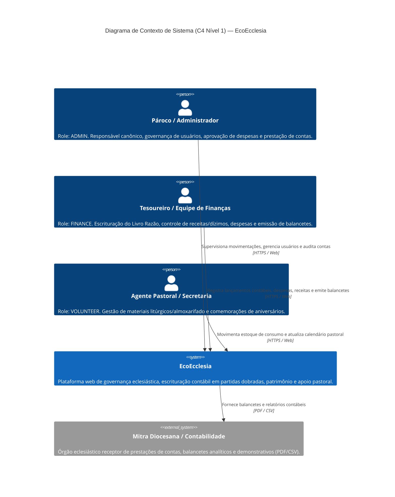

# C4 — Nível 1: Contexto de Sistema (C4Context)

## Propósito
Este documento define a fronteira macro do sistema **EcoEcclesia** e suas interações com os atores humanos reais identificados no inventário (`ADMIN`, `FINANCE` e `VOLUNTEER`) e órgãos de auditoria externa.

**Data de revisão:** 17 de novembro de 2026  
**Status:** Vigente  

---

## 1. Diagrama de Contexto de Sistema (C4Context)

---

## 2. Atores Fatuais do Inventário

* **`ADMIN` (Pároco / Presidente):**
  * Presente no `UserRole.java:4` e seed `V2__insert_default_users.sql:7-23`.
  * Possui privilégios de acesso total a usuários, finanças e inventário.
* **`FINANCE` (Tesoureiro / Conselho Econômico):**
  * Presente no `UserRole.java:4` e seed `V2__insert_default_users.sql:24-40`.
  * Responsável direto pela escrituração do Razão (`LedgerApiController`), relatórios (`ReportApiController`) e fluxo financeiro (`ApiController`).
* **`VOLUNTEER` (Agente Pastoral / Voluntário):**
  * Presente no `UserRole.java:4` e seed `V2__insert_default_users.sql:41-48`.
  * Atua na conferência de estoque de consumo (`InventoryApiController`) e celebrações comunitárias (`BirthdayApiController`).

---

## 3. Pendências / A confirmar

1. **Acesso Externo da Diocese:** Confirmar se a Mitra Diocesana terá acesso direto somente-leitura ao sistema com um perfil dedicado (`AUDITOR`), ou se a prestação continuará ocorrendo exclusivamente por envio manual de arquivos PDF/CSV.
2. **Autoatendimento do Dizimista:** Confirmar se fiéis terão acesso futuro para consulta de demonstrativo individual de dízimo e certidões pastorais.
