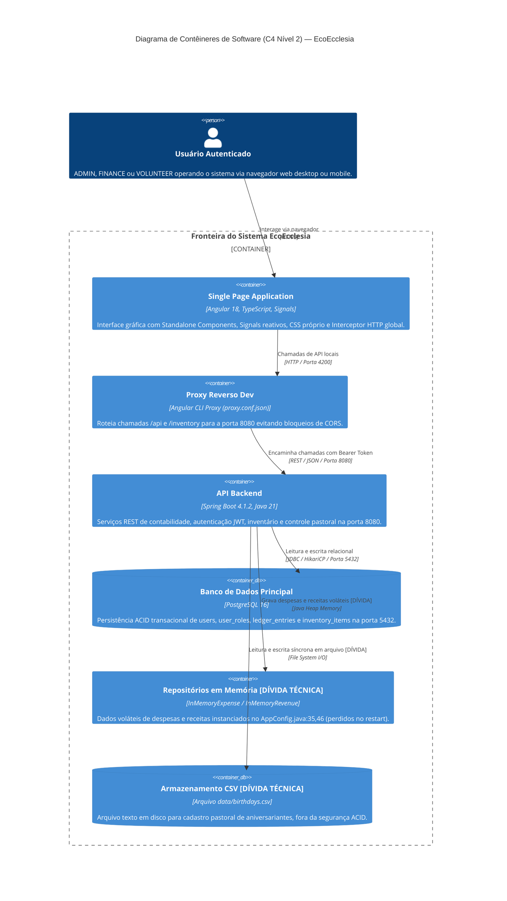

# C4 — Nível 2: Contêineres de Software (C4Container)

## Propósito
Este documento detalha os contêineres de software do **EcoEcclesia** a partir das evidências factuais do inventário, explicitando as tecnologias em uso, portas, protocolos e as dívidas técnicas em transição (repositórios em memória e arquivos CSV).

**Data de revisão:** 17 de novembro de 2026  
**Status:** Vigente  

---

## 1. Diagrama de Contêineres de Software (C4Container)

---

## 2. Detalhamento Factual dos Contêineres e Dívidas Técnicas

### Contêineres de Produção
* **Frontend SPA (`src/frontend`):**
  * Desenvolvido em Angular 18 sem dependências externas de UI, usando Signals reativos para controle de estado.
  * Executa na porta `4200` em desenvolvimento e despacha chamadas via proxy interno.
* **API Backend (`src/main/java`):**
  * Spring Boot 4.1.2 rodando sobre Java 21 na porta `8080`.
  * Gerencia a emissão de relatórios (`ReportApiController`), validação de contas contábeis (`LedgerApiController`) e autenticação de tokens (`AuthController`).
* **Banco de Dados Relacional (`PostgreSQL 16`):**
  * Porta padrão `5432` com pool HikariCP.
  * Gerenciado via Flyway para `users`, `user_roles` e `inventory_items`.

### Dívidas Técnicas em Transição Destacadas
1. **Repositórios em Memória (`InMemoryExpenseRepository` / `InMemoryRevenueRepository`):**
   * **Evidência:** `AppConfig.java:35,46`.
   * **Impacto:** Embora o schema Flyway V1 crie as tabelas `expenses` e `revenues`, a injeção de dependência atual utiliza HashMaps em memória. Lançamentos realizados pelo `ApiController` são perdidos sempre que o serviço é reiniciado.
2. **Persistência em Arquivo Texto (`data/birthdays.csv`):**
   * **Evidência:** `CsvBirthdayRepository.java:13-50` e `AppConfig.java:86`.
   * **Impacto:** Aniversariantes são lidos e gravados de forma concorrente em arquivo físico no disco, sem suporte a transações ACID ou backup relacional integrado.

---

## 3. Pendências / A confirmar

1. **Substituição dos Repositórios em Memória por JDBC:** Criação de `JdbcExpenseRepository` e `JdbcRevenueRepository` utilizando `NamedParameterJdbcTemplate` ou Spring Data JDBC apontando para as tabelas `expenses` e `revenues` já existentes.
2. **Aposentadoria de `data/birthdays.csv`:** Migração definitiva do conteúdo para a tabela `members` via Flyway `V4`.
3. **Estratégia de Empacotamento de Produção:** Definição se o Frontend compilado (`dist/`) será servido pelo Nginx em contêiner independente ou empacotado estaticamente no diretório `src/main/resources/static` do Spring Boot.
