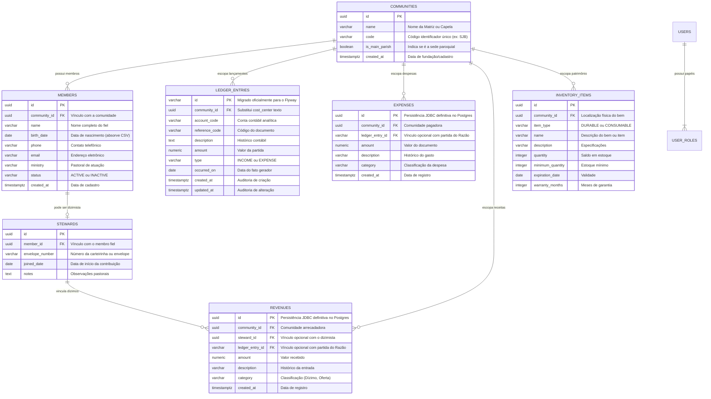

# Modelo Entidade-Relacionamento (ER Atual vs. Alvo)

## Propósito
Este documento mapeia o modelo de dados factual do **EcoEcclesia** a partir do inventário do código, confrontando o estado relacional atual com o modelo alvo normalizado por comunidades e membros.

**Data de revisão:** 17 de novembro de 2026  
**Status:** Vigente  

---

## 1. Diagrama ER Atual (As-Is — Fiel ao Inventário)

> **Notas de integridade do estado atual:**
> * `EXPENSES` e `REVENUES`: Tabelas criadas no PostgreSQL pela migration Flyway `V1`, porém o `AppConfig.java` instancia `InMemoryExpenseRepository` e `InMemoryRevenueRepository` (dados voláteis perdidos no restart).
> * `LEDGER_ENTRIES`: Tabela criada via DDL em tempo de execução pelo `JdbcLedgerGateway.java:33-43`, totalmente fora do controle do Flyway.
> * `LEGACY_BIRTHDAYS`: Não é tabela de banco; persiste em arquivo físico de texto `data/birthdays.csv` fora das garantias ACID.
> * `cost_center`: String textual livre em `LEDGER_ENTRIES`, sem integridade referencial.

```mermaid
erDiagram
    USERS ||--|{ USER_ROLES : "possui papéis"
    USERS {
        uuid id PK
        varchar email UK "Email único de acesso"
        varchar password "Hash SHA-256 Base64"
    }
    USER_ROLES {
        uuid user_id PK, FK "Referência a users(id)"
        varchar role PK "ADMIN, FINANCE ou VOLUNTEER"
    }

    EXPENSES {
        uuid id PK "Flyway V1 (AppConfig usa InMemory - Volátil)"
        numeric amount "Valor da despesa"
        varchar description "Histórico descritivo"
        varchar category "Categoria textual"
        timestamptz created_at "Data de registro"
    }

    REVENUES {
        uuid id PK "Flyway V1 (AppConfig usa InMemory - Volátil)"
        numeric amount "Valor da receita"
        varchar description "Histórico descritivo"
        varchar category "Categoria textual"
        timestamptz created_at "Data de registro"
    }

    INVENTORY_ITEMS {
        uuid id PK "Flyway V1"
        varchar item_type "DURABLE ou CONSUMABLE"
        varchar name "Nome do bem"
        varchar description "Detalhes do item"
        integer quantity "Saldo atual em estoque"
        integer minimum_quantity "Estoque de segurança"
        date expiration_date "Validade (consumíveis)"
        integer warranty_months "Garantia em meses (duráveis)"
    }

    LEDGER_ENTRIES {
        varchar id PK "DDL runtime no JdbcLedgerGateway (Fora do Flyway)"
        varchar account_code "Conta do plano contábil"
        varchar reference_code "Código de documento/recibo"
        varchar cost_center "TEXTO LIVRE (Sem FK para comunidade)"
        text description "Histórico da partida"
        numeric amount "Valor monetário"
        varchar type "INCOME ou EXPENSE"
        date occurred_on "Data do fato contábil"
        timestamptz created_at "Timestamp de criação"
        timestamptz updated_at "Timestamp de atualização"
    }

    LEGACY_BIRTHDAYS {
        string id PK "CSV em disco (data/birthdays.csv fora do banco)"
        string name "Nome da pessoa"
        date birthDate "Data de nascimento"
        string ministry "Pastoral atuante"
        string contact "Telefone ou email"
    }
```

---

## 2. Diagrama ER Alvo (To-Be — Normalizado por Comunidade e Membro)

> **Principais transformações:**
> * `COMMUNITIES`: Eixo de governança da paróquia (Matriz e Capelas).
> * `MEMBERS`: Centro de gravidade pastoral e relacional, absorvendo os aniversariantes do CSV.
> * `STEWARDS`: Dizimistas vinculados diretamente a um `MEMBERS`, com envelope/código canônico.
> * `community_id`: Chave estrangeira mandatória em `LEDGER_ENTRIES`, `EXPENSES`, `REVENUES` e `INVENTORY_ITEMS`.
> * `LEDGER_ENTRIES`: Formalizada sob versionamento do Flyway.

---

## 3. Diff Atual → Alvo (Plano de Transformação do Schema)

| Ação | Objeto | Migration Proposta | Arquivos Afetados (do Inventário) |
| :--- | :--- | :--- | :--- |
| **Mover / Oficializar** | Tabela `ledger_entries` para controle formal de schema | `V3__create_ledger_entries.sql` | `JdbcLedgerGateway.java:33-43`, `infra/sql/ledger-postgres.sql` |
| **Criar / Migrar** | Tabela `birthdays` no PostgreSQL (absorvendo `birthdays.csv`) | `V4__create_birthdays_table.sql` | `data/birthdays.csv`, `CsvBirthdayRepository.java`, `BirthdayApiController.java` |
| **Criar** | Tabela `communities` (Matriz e Capelas filiadas) | `V5__create_communities.sql` | `AppConfig.java`, novos models e repositórios |
| **Criar** | Tabela `members` (centro de gravidade pastoral unificado) | `V6__create_members.sql` | `BirthdayPerson.java`, `BirthdayService.java` |
| **Criar** | Tabela `stewards` (extensão de membros para gestão do dízimo) | `V7__create_stewards.sql` | `RevenueService.java`, `ApiController.java` |
| **Alterar** | Adicionar `community_id UUID NULL` em `ledger_entries`, `expenses`, `revenues`, `inventory_items` | `V8__add_community_id_to_financial.sql` | `V1__initialize_schema.sql`, `SqlLedgerRepository.java`, `ApiController.java`, `InventoryApiController.java` |
| **Alterar / Saneamento** | Backfill de `cost_center` para `community_id`, drop da coluna `cost_center` e `SET NOT NULL` | `V9__migrate_cost_center_to_community.sql` | `LedgerEntry.java:10`, `LedgerService.java:25`, `LedgerApiController.java:46`, `dashboard-page.component.ts:49`, `ledger-page.component.ts:95` |

---

## 4. Pendências / A confirmar

1. **Vínculo Explícito entre Despesa/Receita e Razão:** Confirmar se `EXPENSES` e `REVENUES` devem manter chave estrangeira `ledger_entry_id` apontando para a partida dobrada do Razão, ou se o Razão deve ser a fonte primária única de escrituração financeira.
2. **Multi-pertença de Membros:** Confirmar se um fiel pode ser membro ativo de mais de uma comunidade simultaneamente (ex.: atua no conselho da Matriz e participa da liturgia na Capela São João Bosco).
3. **Auditoria de Autoria (`created_by`):** Definir se todas as entidades alvo devem incluir foreign key `created_by` apontando para `users(id)` para rastreabilidade de autoria operacional.
