# Trilha de Migrações Flyway (V1..V9)

## Propósito
Este documento detalha o encadeamento cronológico e funcional das migrações do banco de dados PostgreSQL via Flyway, convertendo o estado legado e volátil atual em um modelo de dados relacional e escopado por comunidades.

**Data de revisão:** 17 de novembro de 2026  
**Status:** Vigente  

---

## 1. Fluxo de Dependências das Migrações

```mermaid
flowchart LR
    V1["V1__initialize_schema<br/>[Existente]"] --> V2["V2__insert_default_users<br/>[Existente]"]
    V2 --> V3["V3__create_ledger_entries<br/>[Oficializar Razão]"]
    V3 --> V4["V4__create_birthdays_table<br/>[Extinguir CSV]"]
    V4 --> V5["V5__create_communities<br/>[Criar Comunidades]"]
    V5 --> V6["V6__create_members<br/>[Centro de Membros]"]
    V6 --> V7["V7__create_stewards<br/>[Dizimistas]"]
    V7 --> V8["V8__add_community_id_to_financial<br/>[Colunas de Escopo]"]
    V8 --> V9["V9__migrate_cost_center_to_community<br/>[Backfill & Saneamento]"]
```

---

## 2. Especificação Individual das Migrações (V1..V9)

### `V1__initialize_schema.sql` (Existente)
* **Propósito:** Cria as tabelas fundamentais de autenticação (`users`, `user_roles`) e as entidades de despesas, receitas e patrimônio (`expenses`, `revenues`, `inventory_items`).
* **Arquivos que mudam:** `src/main/resources/db/migration/V1__initialize_schema.sql` (arquivo imutável já aplicado no banco).

### `V2__insert_default_users.sql` (Existente)
* **Propósito:** Insere os usuários administrativos e operacionais de seed com senha padrão criptografada para os papéis `ADMIN`, `FINANCE` e `VOLUNTEER`.
* **Arquivos que mudam:** `src/main/resources/db/migration/V2__insert_default_users.sql` (arquivo imutável já aplicado no banco).

### `V3__create_ledger_entries.sql`
* **Propósito:** Cria a tabela oficial `ledger_entries` com índices por data e conta dentro do controle de versão do Flyway, eliminando a execução de DDL em tempo de execução.
* **Arquivos que mudam:** `src/main/java/com/ecoeclesia/finance/JdbcLedgerGateway.java:33-43` (remove criação síncrona via JDBC Statement) e `infra/sql/ledger-postgres.sql`.

### `V4__create_birthdays_table.sql`
* **Propósito:** Cria a tabela relacional `birthdays` no PostgreSQL para absorver o cadastro de pessoas físicas, habilitando a aposentadoria do arquivo `data/birthdays.csv`.
* **Arquivos que mudam:** `src/main/java/com/ecoeclesia/birthday/CsvBirthdayRepository.java`, `src/main/java/com/ecoeclesia/api/BirthdayApiController.java`, `src/main/java/com/ecoeclesia/config/AppConfig.java`.

### `V5__create_communities.sql`
* **Propósito:** Cria a tabela `communities` e insere os registros fundamentais da paróquia: sede principal ("Matriz Paroquial") e capela ("Comunidade São João Bosco").
* **Arquivos que mudam:** Novos arquivos de entidade e repositório `CommunityEntity.java`, `JdbcCommunityRepository.java` e `src/main/java/com/ecoeclesia/config/AppConfig.java`.

### `V6__create_members.sql`
* **Propósito:** Cria a tabela `members` com chave estrangeira para `communities(id)`, unificando o centro pastoral de dados de fiéis e agentes de pastorais.
* **Arquivos que mudam:** `src/main/java/com/ecoeclesia/birthday/BirthdayPerson.java`, `src/main/java/com/ecoeclesia/birthday/BirthdayService.java` e novos serviços de membros.

### `V7__create_stewards.sql`
* **Propósito:** Cria a tabela `stewards` associada a `members(id)` para controle de dízimo e adiciona chave estrangeira opcional `steward_id` na tabela `revenues`.
* **Arquivos que mudam:** `src/main/java/com/ecoeclesia/revenue/RevenueService.java`, `src/main/java/com/ecoeclesia/api/ApiController.java:101-171`.

### `V8__add_community_id_to_financial.sql`
* **Propósito:** Adiciona a coluna `community_id UUID NULL REFERENCES communities(id)` nas tabelas `ledger_entries`, `expenses`, `revenues` e `inventory_items`.
* **Arquivos que mudam:** `LedgerEntry.java:10`, `ExpenseDocument.java`, `RevenueEntity.java`, `InventoryItem.java`, `LedgerApiController.java:40-48`.

### `V9__migrate_cost_center_to_community.sql`
* **Propósito:** Executa script de saneamento/backfill mapeando os textos de `cost_center` para as comunidades correspondentes, torna `community_id NOT NULL` e descarta a coluna `cost_center`.
* **Arquivos que mudam:** `LedgerEntry.java`, `LedgerService.java:25-46`, `LedgerApiController.java:46,108`, `FinancialReportGenerator.java:68`, `dashboard-page.component.ts:49`, `ledger-page.component.ts:95`.

---

## 3. Pendências / A confirmar

1. **Estratégia de Execução em Produção:** Confirmar se o banco atual de desenvolvimento/produção contém dados em `ledger_entries` criados pelo DDL manual para garantir que a migration `V3` utilize cláusula `CREATE TABLE IF NOT EXISTS` sem gerar conflitos.
2. **Backfill de `cost_center` Inéditos:** Validar se existem registros no banco cujo valor de `cost_center` seja diferente de "Matriz", "Geral" ou "São João Bosco", definindo a comunidade de destino para cada caso.
3. **Persistência de Despesas/Receitas:** Confirmar a substituição simultânea dos repositórios em memória no `AppConfig.java` na aplicação da migration `V8`.
