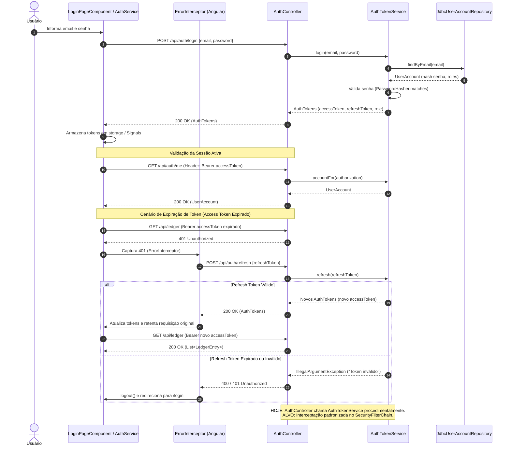
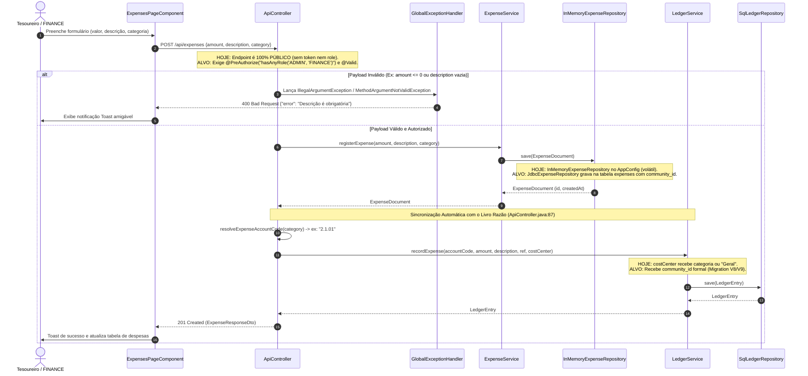
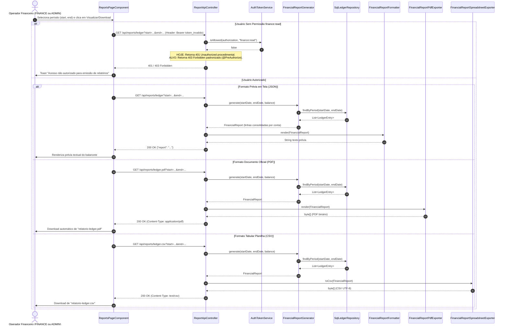
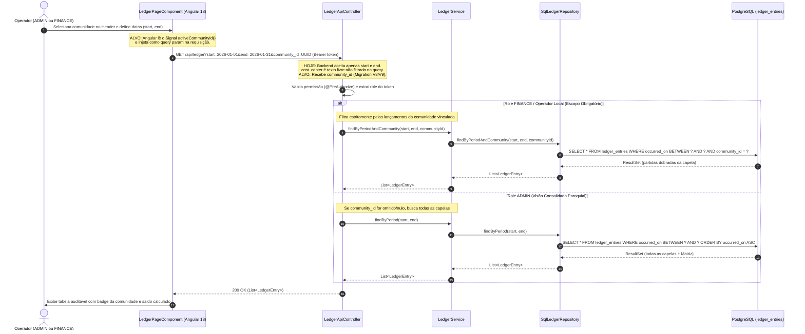

# Fluxos de Sequência do Sistema (Sequence Diagrams)

## Propósito
Este documento modela os fluxos de execução fim a fim dos casos de uso críticos do **EcoEcclesia** a partir do inventário factual do código, contrastando as vulnerabilidades e comportamentos procedurais atuais (**HOJE**) com a arquitetura protegida e escopada (**ALVO**).

**Data de revisão:** 17 de novembro de 2026  
**Status:** Vigente  

---

## 1. Fluxo de Login, Validação de Sessão e Renovação de Token (JWT)

Mapeia a autenticação inicial (`/api/auth/login`), a consulta de perfil (`/api/auth/me`), a expiração do token de acesso (401) e o ciclo de renovação via refresh token (`/api/auth/refresh`).

---

## 2. Fluxo de Lançamento de Despesa com Entrada Espelho no Razão (Fim a Fim)

Mapeia a criação de despesa via `ExpensesPageComponent` (`POST /api/expenses`), o lançamento espelho no Razão Contábil (`LedgerService`), a validação de dados e o tratamento de erros.

---

## 3. Fluxo de Emissão de Relatórios Contábeis (JSON, PDF e CSV)

Mapeia a geração e exportação de balancetes a partir do `ReportsPageComponent` chamando `ReportApiController` (`/api/reports/ledger`, `.pdf`, `.csv`), destacando a checagem de permissão e formatos suportados.

---

## 4. Fluxo de Consulta do Razão com Filtros e Escopo de Comunidade (ALVO)

Mapeia a listagem analítica do Livro Razão (`LedgerPageComponent` / `DashboardPageComponent`) aplicando filtros de período e isolamento por comunidade (`community_id`), diferenciando o escopo restrito de capela da visão consolidada da Matriz.

---

## Pendências / A confirmar

1. **Assinatura do JWT com Claim de Comunidade:** Confirmar se o payload do access token emitido pelo `AuthTokenService` deve incluir a claim `community_id` padrão do usuário para evitar passagem redundante de query params.
2. **Fallback da Entrada Espelho de Despesa:** No `ApiController.java:88`, a chamada `ledgerService.recordExpense` está envolvida em bloco `try { ... } catch (Exception ignored) {}`. Confirmar se uma falha no Razão deve realizar rollback transacional (`@Transactional`) da despesa gravada para garantir integridade contábil estrita.
3. **Formato do Retorno de Relatório JSON:** O endpoint `GET /api/reports/ledger` retorna `{ "report": String }` (texto formatado com quebras de linha monoespaçadas). Confirmar se o frontend continuará exibindo em bloco `<pre>` ou se o relatório deve ser estruturado em objeto JSON com nós analíticos de contas e totais.
