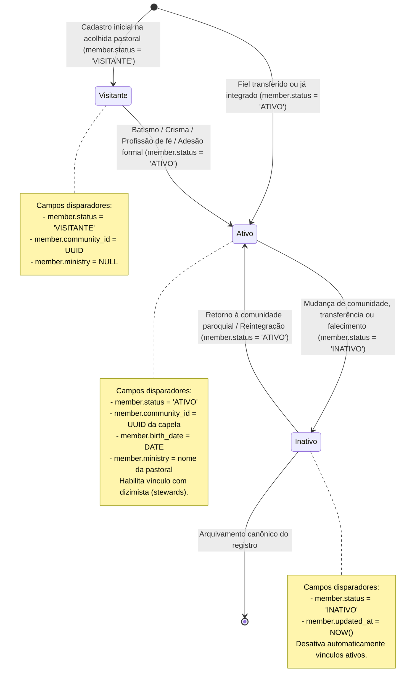
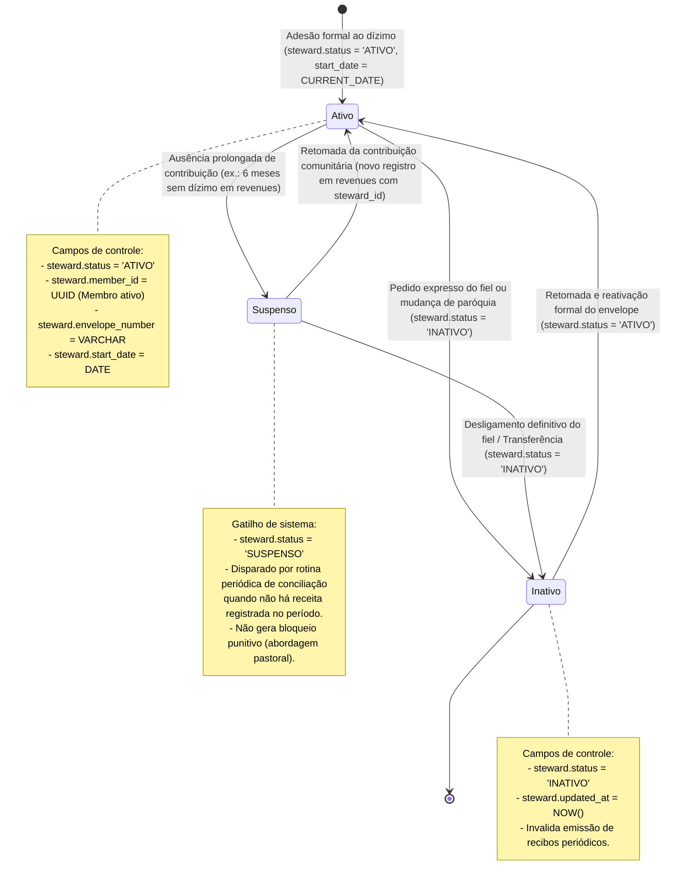
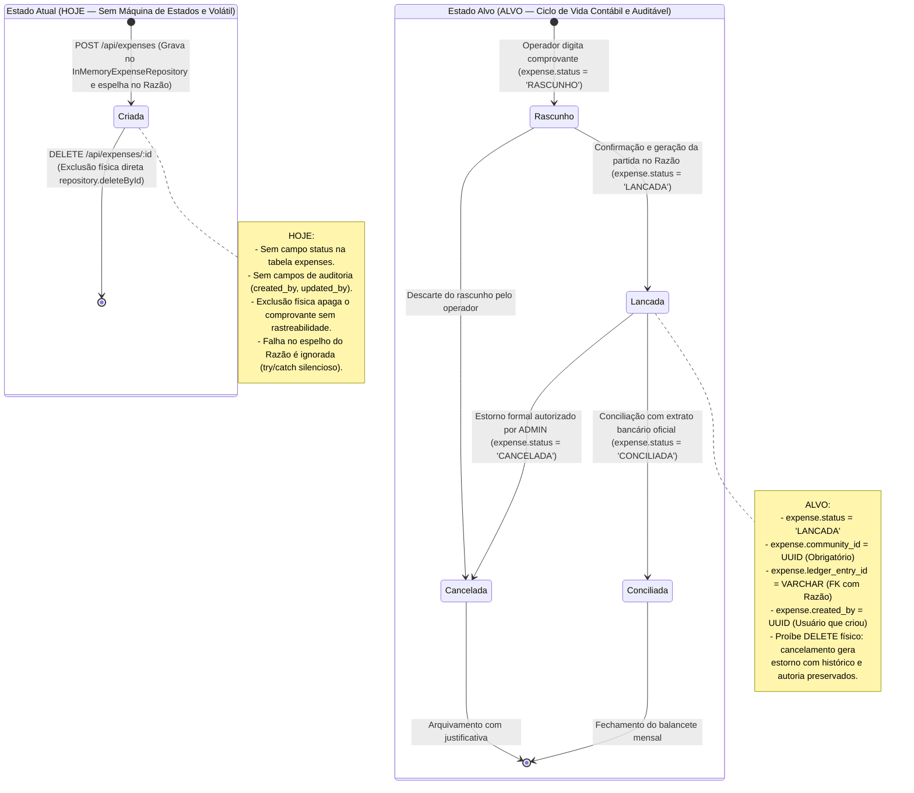

# Máquinas de Estados do Domínio (State Diagrams)

## Propósito
Este documento modela o ciclo de vida e as transições de estado das entidades centrais do **EcoEcclesia** (`members`, `stewards` e `expenses`), confrontando a ausência atual de controle de ciclo de vida com os estados finitos e auditáveis do modelo alvo.

**Data de revisão:** 17 de novembro de 2026  
**Status:** Vigente  

---

## 1. Ciclo de Vida de Membro (`members` — Alvo: Migration V6)

O fiel da comunidade deixa de ser um registro estático de aniversário em arquivo CSV e assume uma jornada eclesial e relacional com a paróquia.

---

## 2. Ciclo de Vida do Dizimista (`stewards` — Alvo: Migration V7)

Modela a participação financeira fraternal do fiel na manutenção pastoral e física do templo, preservando a dignidade humana e o sigilo das contribuições.

---

## 3. Ciclo de Vida de Despesa (`expenses` — Atual vs. Alvo)

Contrasta o mecanismo simplório e volátil atual (onde registros são criados ou deletados fisicamente sem rastro) com o ciclo de vida auditável e em conformidade contábil.

---

## 4. Comparativo de Auditoria e Integridade Contábil

| Critério | Estado Atual (HOJE) | Estado Proposto (ALVO) |
| :--- | :--- | :--- |
| **Campo de Status** | Inexistente (entidade nasce ativa e morre ao deletar). | `status` estruturado como Enum canônico e contábil. |
| **Exclusão de Registros** | Exclusão física no banco (`DELETE FROM expenses WHERE id = ?`). | Exclusão lógica com transição para `CANCELADA` preservando histórico. |
| **Rastreabilidade de Autoria** | Nenhuma tabela possui `created_by` ou `updated_by`. | `created_by` (UUID) e `updated_by` (UUID) auditados via Spring Security. |
| **Timestamp de Modificação** | Inexistente em `expenses` e `revenues` (só têm `created_at`). | `created_at` e `updated_at` preenchidos automaticamente. |
| **Vínculo com o Razão** | Chamada procedural solta em bloco `try/catch ignored`. | Vínculo bidirecional transacional (`ledger_entry_id`) com rollback em falha. |

---

## 5. Pendências / A confirmar

1. **Gatilho de Suspensão de Dizimista:** Confirmar se o prazo de inadimplência para transição de `stewards.status` de `ATIVO` para `SUSPENSO` deve ser de 3, 6 ou 12 meses sem lançamentos de dízimo.
2. **Reversão de Despesa Conciliada:** Definir se uma despesa no estado `CONCILIADA` pode ser reaberta ou estornada (exige lançamento contábil compensatório no Razão) ou se é terminantemente bloqueada contra alterações.
3. **Migração do Status de Membros Existentes:** Ao importar os registros de `data/birthdays.csv` para a tabela `members` (Migration `V4`/`V6`), confirmar se todos devem nascer com o status `'ATIVO'` por padrão.
