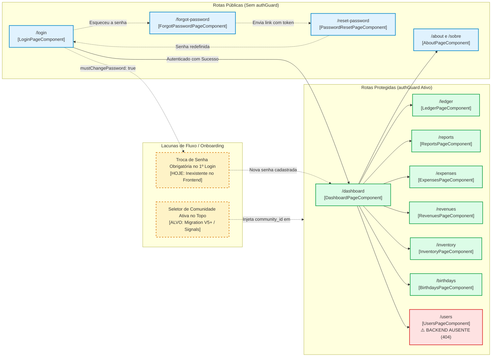

# Mapa de Telas e Navegação (Frontend Angular 18)

## Propósito
Este documento mapeia todas as rotas e telas do frontend Angular 18 a partir do arquivo factual `app.routes.ts`, evidenciando o escopo de proteção do `authGuard`, as rotas públicas, os gargalos de backend e as lacunas no fluxo de onboarding do usuário.

**Data de revisão:** 19 de novembro de 2026  
**Status:** Vigente  

---

## 1. Mapa de Navegação e Rotas (`flowchart LR`)

---

## 2. Detalhamento Factual das Telas e Proteção

| Rota | Componente Standalone | Proteção (`authGuard`) | Status Backend | Observação |
| :--- | :--- | :--- | :--- | :--- |
| `/login` | `LoginPageComponent` | **Pública** | Operacional | Formulário de e-mail e senha. Recebe `AuthTokens`. |
| `/forgot-password` | `ForgotPasswordPageComponent` | **Pública** | Operacional | Solicitação de e-mail para geração de token de reset. |
| `/reset-password` | `PasswordResetPageComponent` | **Pública** | Operacional | Recebe token via query param e cadastra nova senha. |
| `/about` e `/sobre` | `AboutPageComponent` | **Pública** | Sem backend | Conteúdo estático e afetivo: propósito, Dom Bosco, homenagens (*In Memoriam*). |
| `/dashboard` | `DashboardPageComponent` | **Protegida** | Operacional | Gráfico Donut de Receitas x Despesas, saldo e atalho de novo lançamento. |
| `/ledger` | `LedgerPageComponent` | **Protegida** | Operacional | Tabela do Razão Contábil, busca textual por `cost_center` e modal de escrituração. |
| `/reports` | `ReportsPageComponent` | **Protegida** | Operacional | Emissão de balancetes e download em PDF/CSV. |
| `/expenses` | `ExpensesPageComponent` | **Protegida** | Operacional (Volátil) | Gestão de despesas vinculadas a repositório em memória. |
| `/revenues` | `RevenuesPageComponent` | **Protegida** | Operacional (Volátil) | Gestão de receitas/dízimos vinculadas a repositório em memória. |
| `/inventory` | `InventoryPageComponent` | **Protegida** | Operacional | Gestão de bens duráveis e consumíveis com alerta de estoque baixo. |
| `/birthdays` | `BirthdaysPageComponent` | **Protegida** | Operacional (CSV) | Listagem com destaque para quem comemora hoje ou em até 7 dias. |
| `/users` | `UsersPageComponent` | **Protegida** | **FALHA (404)** | O backend Spring Boot **não possui** `UserApiController` mapeando `/api/users`. |

---

## 3. Lacunas de Experiência e Onboarding Identificadas

1. **Troca de Senha Obrigatória no Primeiro Acesso:**
   * **Evidência no Backend:** O record `AuthTokens.java:8` já transporta o campo `mustChangePassword`, mas o frontend ignora o atributo após o login e navega direto para o `/dashboard`.
   * **Alvo:** Redirecionar usuários recém-criados com senha temporária (`Senhainicial123`) para tela de alteração obrigatória de credencial antes de liberar as rotas protegidas.
2. **Ausência do Seletor Global de Comunidade:**
   * **Estado Atual:** Todas as telas de lançamento financeiro (`/dashboard` e `/ledger`) forçam a digitação manual de texto livre para `costCenter` (com default fixo em `"Geral"`).
   * **Alvo (V5+):** Dropdown fixo no topo da aplicação permitindo ao usuário alternar a capela ativa, sincronizado via Signal reativo (`activeCommunityId`) e persistido na sessão.

---

## 4. Pendências / A confirmar

1. **Destino do Redirecionamento 404 em `/users`:** Confirmar se a tela `/users` deve exibir estado amigável com mascote Dom Bosquinho enquanto o `UserApiController` não for implementado no Spring Boot.
2. **Permissões Granulares por Rota Angular:** Avaliar a criação de `roleGuard` para impedir que usuários `VOLUNTEER` visualizem opções de menu e rotas financeiras restritas (`/ledger`, `/reports`).
