# Documentação Viva de Arquitetura & Domínio — EcoEcclesia

## Propósito
Este documento atua como o catálogo mestre e guia central de navegação da documentação técnica viva (*docs-as-code*) do **EcoEcclesia**, organizando os artefatos de inventário factual, modelagem C4, arquitetura de dados e trilhas evolutivas.

**Data de revisão:** 19 de novembro de 2026  
**Status:** Vigente  

---

## 1. Ordem de Leitura Recomendada

Para compreender a fundo o sistema, suas dívidas técnicas e a transição planejada para comunidades e membros, siga a trilha:

```mermaid
flowchart LR
    D00["00-inventario<br/>[Base Factual]"] --> D04["04-modelo-er<br/>[Dados Atual vs. Alvo]"]
    D04 --> D05["05-migracoes-flyway<br/>[Trilha V1..V9]"]
    D05 --> D06["06-permissoes-rbac<br/>[Segurança & Roles]"]
    D06 --> D02["02/03-c4-model<br/>[Contexto & Contêineres]"]
    D02 --> D07["07-fluxos-sequencia<br/>[Ciclos Fim a Fim]"]
    D07 --> D08["08-maquinas-estado<br/>[Ciclo de Vida de Entidades]"]
    D08 --> D09["09-mapa-telas<br/>[Frontend & Rotas]"]
    D09 --> D10["10-roadmap<br/>[Planejamento Fases A..D]"]
```

$$\mathbf{00} \longrightarrow \mathbf{04} \longrightarrow \mathbf{05} \longrightarrow \mathbf{06} \longrightarrow \mathbf{02/03} \longrightarrow \mathbf{07} \longrightarrow \mathbf{08} \longrightarrow \mathbf{09} \longrightarrow \mathbf{10}$$

---

## 2. Catálogo Geral de Documentos (00 a 10)

| Arquivo | Propósito (1 linha) |
| :--- | :--- |
| [00-inventario.md](00-inventario.md) | Levantamento factual e estático de todas as tabelas, endpoints, telas, centro de custo e lacunas do código. |
| [02-c4-contexto.md](02-c4-contexto.md) | Diagrama C4 Nível 1 definindo fronteiras do sistema, atores humanos (`ADMIN`, `FINANCE`, `VOLUNTEER`) e Diocese. |
| [03-c4-containers.md](03-c4-containers.md) | Diagrama C4 Nível 2 detalhando Angular 18, proxy dev, Spring Boot 4.1.2, Postgres 16 e destacando dívidas técnicas. |
| [04-modelo-er.md](04-modelo-er.md) | Diagramas ER atual (*As-Is*) e alvo (*To-Be*) com `communities`, `members`, `stewards` e diff de transformação. |
| [05-migracoes-flyway.md](05-migracoes-flyway.md) | Trilha cronológica sequencial das migrações Flyway (`V1` a `V9`) com arquivos afetados em cada etapa. |
| [06-permissoes-rbac.md](06-permissoes-rbac.md) | Matriz RBAC de papéis versus recursos, inconsistências de código (401 vs 403) e mapeamento de `@PreAuthorize`. |
| [07-fluxos-sequencia.md](07-fluxos-sequencia.md) | Diagramas de sequência para Login/Refresh JWT, Despesa com entrada no Razão, Relatórios e Consulta com escopo. |
| [08-maquinas-estado.md](08-maquinas-estado.md) | Máquinas de estados finitos para `Member` (V6), `Steward` (V7) e contraste de `Expense` (atual volátil vs alvo auditável). |
| [09-mapa-telas.md](09-mapa-telas.md) | Mapa de navegação das rotas Angular (`app.routes.ts`), indicando rotas públicas, protegidas e a lacuna da tela `/users`. |
| [10-roadmap.md](10-roadmap.md) | Plano de implementação priorizado por Impacto × Esforço agrupado nas Fases A (Segurança), B, C e D. |

*Documentos complementares arquivados de apoio contábil:*
* [_legacy/chart-of-accounts-glossary.md](_legacy/chart-of-accounts-glossary.md) — Dicionário canônico e contábil do Plano de Contas.
* [_legacy/backlog.md](_legacy/backlog.md) — Histórico de demandas e funcionalidades iniciais.

---

## 3. Diretrizes de Governança Docs-as-Code ("Como Atualizar")

> [!IMPORTANT]
> **A Regra de Ouro:** Toda migration nova entra obrigatoriamente no mesmo Pull Request que atualiza o [04-modelo-er.md](04-modelo-er.md) e o [05-migracoes-flyway.md](05-migracoes-flyway.md).

1. **Evolução de Schema SQL:** Ao criar uma migration (`V(n)__...sql`), atualize o modelo ER alvo/atual em `04-modelo-er.md` e incremente o fluxo do Flyway em `05-migracoes-flyway.md`.
2. **Novos Endpoints ou Telas:** A introdução de qualquer nova rota REST ou página Angular deve atualizar o inventário [00-inventario.md](00-inventario.md), a matriz de segurança [06-permissoes-rbac.md](06-permissoes-rbac.md) e os mapas [07-fluxos-sequencia.md](07-fluxos-sequencia.md) ou [09-mapa-telas.md](09-mapa-telas.md).
3. **Formato Mermaid Estrito:** Não comitar capturas de tela ou imagens PNG/JPG binárias de diagramas. Todas as representações visuais devem permanecer versionadas em blocos de código com sintaxe Mermaid pura.

---

## 4. Pendências / A confirmar

1. **Criação de Documento Executivo (`01-visao-geral.md`):** Avaliar a necessidade de redigir uma visão executiva concisa de alto nível voltada para o pároco e conselho eclesiástico leigo.
2. **Integração de Docs no Pipeline CI/CD:** Adicionar step de validação de Markdown e sintaxe de Mermaid nas verificações automatizadas de Pull Request.
